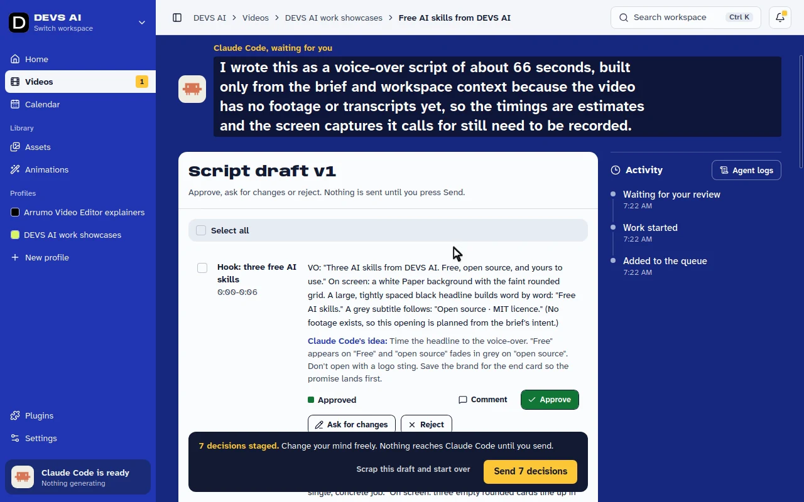
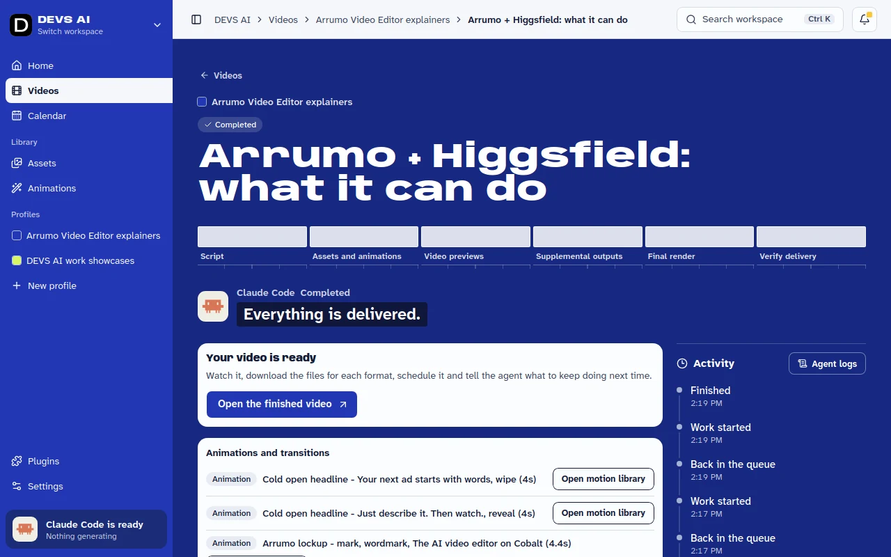

<p align="center">
  
</p>

<h1 align="center">Arrumo AI Video Editor</h1>

<p align="center"><b>Describe the video. An AI agent writes, designs, voices and cuts it in your brand. You approve every step.</b></p>

<p align="center">
  <a href="LICENSE"></a>
  
  
  <a href="https://www.aidevs.pt/tools/arrumo/docs"></a>
</p>

<p align="center">
  <a href="https://www.aidevs.pt/tools/arrumo"><b>Download</b></a> ·
  <a href="https://www.aidevs.pt/tools/arrumo/docs/user/tutorial">Tutorial</a> ·
  <a href="https://www.aidevs.pt/tools/arrumo/docs">Documentation</a> ·
  <a href="https://www.aidevs.pt/tools/arrumo/docs/developer">Developers</a> ·
  <a href="https://github.com/aidevs-pt/arrumo-plugin-registry">Plugins</a>
</p>

[](https://youtu.be/v2KcwE8xuso)

<p align="center"><sub>Every video on our channel is made entirely in Arrumo: the agent wrote the script, designed the animations, voiced and cut it, and wrote the titles and tags. People only reviewed and approved each step.</sub></p>

## Why Arrumo

Most AI video tools give you a clip and hope you like it. Arrumo works like an editor on your team: it drafts each stage of the video, shows you the work, and waits for your decision before it moves on.

- **Your agent, on your plan.** [Claude Code](https://github.com/aidevs-pt/arrumo-plugin-claude-code) or [Codex](https://github.com/aidevs-pt/arrumo-plugin-codex) does the creative work, signed in on your own computer.
- **Your brand, learned once.** Point it at your website: it drafts your context, colors, fonts and logos, and every video follows them.
- **Review every stage.** Approve, ask for changes or reject the script, the animations, each preview, and every title, description and thumbnail, part by part. Or turn on Autopilot.
- **Real deliverables.** Full-quality files for each format (landscape, portrait cuts), subtitles, titles, descriptions, tags and thumbnails, checked against your rules, scheduled on a calendar and exported as one ZIP.
- **Bring your providers.** [ElevenLabs](https://github.com/aidevs-pt/arrumo-plugin-elevenlabs) for voices, music and dubbing, [OpenAI](https://github.com/aidevs-pt/arrumo-plugin-openai) and [Gemini](https://github.com/aidevs-pt/arrumo-plugin-gemini) for images, [Higgsfield](https://github.com/aidevs-pt/arrumo-plugin-higgsfield) for video clips, [Auto-Dubbing](https://github.com/aidevs-pt/arrumo-plugin-auto-dubbing) for other languages. Every provider is a plugin.
- **Local and private.** Your footage, assets and keys stay on your computer. Anonymous usage counts and crash reports can be turned off in Settings.

<p align="center">
  
</p>

## How it works

| | Stage | What you review |
| --- | --- | --- |
| 1 | **Script** | A voice-over script from your brief, your footage and your brand context |
| 2 | **Assets and animations** | Title cards, lower thirds and transitions in your colors and fonts, plus generated images, clips and music |
| 3 | **Video previews** | A cut of every format with the voice and captions in place |
| 4 | **Supplemental outputs** | Titles, descriptions, tags and thumbnails for each platform |
| 5 | **Final render** | Full-quality files with subtitle files alongside |
| 6 | **Verify delivery** | Every format checked against your output rules, ready to schedule and export |

<p align="center">
  
</p>

## Get started

1. [Download Arrumo](https://www.aidevs.pt/tools/arrumo) for Windows, macOS or Linux. It updates itself and asks before installing a new version.
2. Install and sign in to [Claude Code](https://code.claude.com/docs/en/setup) or [Codex](https://learn.chatgpt.com/docs/codex/cli).
3. Follow the [tutorial](https://www.aidevs.pt/tools/arrumo/docs/user/tutorial): from your website to a finished video, one screen at a time ([Español](https://www.aidevs.pt/es/tools/arrumo/docs/user/tutorial) · [Português](https://www.aidevs.pt/pt/tools/arrumo/docs/user/tutorial)).

## Drive it from your agent

Everything in the app is part of one application API, available to the desktop UI, a command line, **MCP** and **A2A**, with the same rules and approvals. Build the `arrumo-workspaces` binary (`cargo build --locked -p arrumo-workspaces`) and add it to Claude Code, Codex or any MCP client:

```json
{
  "mcpServers": {
    "arrumo": {
      "command": "arrumo-workspaces",
      "args": ["/absolute/path/to/workspaces.sqlite", "mcp"]
    }
  }
}
```

Agents can then create workspaces, start videos and review drafts. Load [`skills/arrumo/SKILL.md`](skills/arrumo/SKILL.md) as a Claude Code or Codex skill for the editing workflow and review checklist. See [Connect to Arrumo](https://www.aidevs.pt/tools/arrumo/docs/developer/connect) for the CLI, MCP and A2A, and the [reference](https://www.aidevs.pt/tools/arrumo/docs/developer/reference) for every command, tool and operation.

## Extend it

Agents and media providers are plugins built with the [Plugin SDK](https://github.com/aidevs-pt/arrumo-plugin-sdk): a manifest, declarative HTTP adapters, optional isolated backend code and settings panels, translated into English, Spanish and Portuguese. The [plugin registry](https://github.com/aidevs-pt/arrumo-plugin-registry) lists the official plugins and their digest-checked releases. Start with [your first plugin](https://www.aidevs.pt/tools/arrumo/docs/developer/first-plugin).

## Documentation

| | English | Español | Português |
| --- | --- | --- | --- |
| Tutorial | [Read](https://www.aidevs.pt/tools/arrumo/docs/user/tutorial) | [Leer](https://www.aidevs.pt/es/tools/arrumo/docs/user/tutorial) | [Ler](https://www.aidevs.pt/pt/tools/arrumo/docs/user/tutorial) |
| Use Arrumo | [Read](https://www.aidevs.pt/tools/arrumo/docs/user) | [Leer](https://www.aidevs.pt/es/tools/arrumo/docs/user) | [Ler](https://www.aidevs.pt/pt/tools/arrumo/docs/user) |
| Build on Arrumo | [Read](https://www.aidevs.pt/tools/arrumo/docs/developer) | [Leer](https://www.aidevs.pt/es/tools/arrumo/docs/developer) | [Ler](https://www.aidevs.pt/pt/tools/arrumo/docs/developer) |
| Official plugins | [Read](https://www.aidevs.pt/tools/arrumo/docs/plugins) | [Leer](https://www.aidevs.pt/es/tools/arrumo/docs/plugins) | [Ler](https://www.aidevs.pt/pt/tools/arrumo/docs/plugins) |

The docs source lives in [arrumo-docs](https://github.com/aidevs-pt/arrumo-docs). For AI agents, every page is also available as Markdown, indexed in [`llms.txt`](https://www.aidevs.pt/tools/arrumo/llms.txt).

## More videos made with Arrumo

| | |
| --- | --- |
| [](https://youtu.be/a8z9Aql6qPg)<br>Arrumo + Higgsfield: a launch film made entirely in Arrumo | [](https://youtu.be/ldBiG89NOvA)<br>From brief to finished video |
| [](https://youtu.be/wBL2fZAUA2k)<br>Your brand in Arrumo | [](https://youtu.be/Z3V6pxL29kw)<br>DEVS AI in a minute |

## Develop

Install the [Tauri prerequisites](https://v2.tauri.app/start/prerequisites/), Node, and the pnpm version in `package.json`.

```sh
pnpm install --frozen-lockfile
pnpm tauri dev
```

Run the backend tests with `cargo test --locked`. In the Arrumo workspace layout, the build loads the default plugins from the sibling `plugin-registry` and `plugins/<id>` checkouts; set `ARRUMO_CORE_ONLY=1` to build without them. See [Build and run the editor](https://www.aidevs.pt/tools/arrumo/docs/developer/reference/build) for release builds, telemetry and update keys, and [`docs/releasing.md`](docs/releasing.md) for publishing a release.

The code follows domain boundaries: `crates/workspaces` holds the business rules and the application API shared by the UI, CLI, MCP and A2A, `src-tauri` is the desktop host, and `src` is the Next.js interface (shadcn, Motion), in English, Spanish and Portuguese.

## Contributing

Contributions are welcome: read [CONTRIBUTING.md](CONTRIBUTING.md) and our [Code of Conduct](CODE_OF_CONDUCT.md). Report security problems privately as described in [SECURITY.md](SECURITY.md).

## License

Copyright © 2026 DEVS AI Unipessoal LDA. Licensed under the [GNU Affero General Public License v3.0](LICENSE).

Arrumo is built by [DEVS AI](https://aidevs.pt), an AI studio in Porto. Need a custom AI solution for your company? [Let's talk](https://aidevs.pt).
